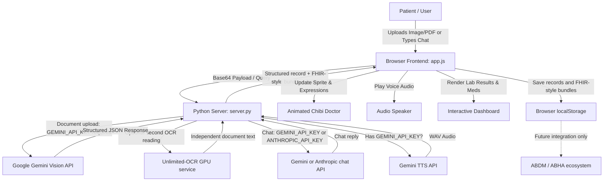

# 🩺 Mr.Doc – Personal AI Health Copilot
#hi

<div align="center">

  

  <h3><em>Your Warm, Multilingual Medical Record Companion & Chibi Doctor Guide</em></h3>

  <p>
    <strong>Translating complex medical reports, prescriptions, and lab tests into plain, reassuring language in your mother tongue.</strong>
  </p>

  <p>
    
    
    
    
    
    
    
  </p>
</div>

---

## 📑 Table of Contents

- [Overview](#-overview)
- [Visual Screen & Character Layout](#-visual-screen--character-layout)
- [Key Features](#-key-features)
- [How It Works (End-to-End Workflow)](#-how-it-works-end-to-end-workflow)
- [System Architecture](#-system-architecture)
- [Dependencies & Prerequisites](#-dependencies--prerequisites)
- [Quickstart: How to Run](#-quickstart-how-to-run)
- [Configuration (.env)](#-configuration-env)
- [Repository Structure](#-repository-structure)
- [API Endpoints Reference](#-api-endpoints-reference)
- [Privacy & Medical Disclaimer](#-privacy--medical-disclaimer)

---

## 🌟 Overview

**Mr.Doc** is an intelligent, privacy-first personal health copilot designed to empower patients and families. Medical records, discharge summaries, and lab reports are frequently packed with intimidating clinical terminology, complex reference ranges, and illegible handwriting.

Mr.Doc bridges this gap:

- **Upload Any Health Document:** Take a photo or upload a PDF of prescriptions, blood tests, or discharge summaries.
- **Multimodal AI OCR:** Automatically reads and parses medications, dosages, lab values, and clinical findings.
- **Plain-Language Explanations:** Explains what high/low test numbers mean and highlights danger signs without clinical jargon.
- **Interactive Animated Doctor:** A friendly chibi avatar with real-time facial expressions, gaze tracking, and speech animations.
- **3D Doctor:** The chat stage loads `assets/mrdoc.glb` in Three.js with six clips (idle, wave, think, talk, explain, reassure) blended over 0.35 s. A skinned placeholder ships so 3D is on by default; replace the file with a Mixamo pack when you have one. If the model is missing, the 2D sprites keep working. See the [3D character pipeline](docs/3d-mrdoc-pipeline.md).
- **Speaks Your Language:** Instant translation and native voice playback in **English**, **Hindi (हिन्दी)**, **Telugu (తెలుగు)**, and **Tamil (தமிழ்)**.
- **Browser-based record storage:** The app saves records in browser local storage; this storage is not encrypted by the app. Uploaded documents and chat context are sent to the AI provider configured for the app when the user requests analysis or chat. No patient database is hosted by this prototype.

---

## 🖥️ Visual Screen & Character Layout

Here is how the application screen is laid out when you launch Mr.Doc:

```text
+--------------------------------------------------------------------------------------------------+
|  🩺 Mr.Doc Health Copilot       [ 🔍 Search Records ]    [ 🌐 EN | हिन्दी | తెలుగు | தமிழ் ] [ 🔊 Voice: ON ]  |
+--------------------------------------------------------------------------------------------------+
|                                  |                                                               |
|   [ CHARACTER AVATAR PANEL ]     |                [ MEDICAL REPORT & RECORD VIEWER ]             |
|                                  |                                                               |
|             ╭──────╮             |   📂 Upload Document: [ 📄 Choose PNG, JPG, PDF (Max 10MB) ]   |
|            │  ^ ‿ ^ │   <-- Chibi  |   ⚡ Or Quick-Load Sample:                                     |
|            │ (  🩺 )│      Doctor |      • 🧪 Blood Test / CBC   • 💊 Prescription  • 🏥 Discharge |
|             ╰──┬─┬─╯             |  -----------------------------------------------------------  |
|                                  |   📋 Extracted Record: Complete Blood Count (CBC)             |
|   "Hello! Your platelet count    |   🏥 Facility: Apollo Diagnostics  | 👨‍⚕️ Doctor: Dr. Sharma      |
|    is back up to safe levels!    |   📅 Date: 12-Oct-2026            | 👤 Patient: Anil Kumar (41M)  |
|    Drink plenty of fluids."      |  -----------------------------------------------------------  |
|                                  |   🧪 Lab Values & Abnormal Markers:                           |
|   [ 🔊 Gemini / Web Voice ]  |      • Platelet Count: 112,000 /mcL  [ ⚠️ LOW - Recovering ]  |
|                                  |      • Hemoglobin:     14.2 g/dL     [ ✅ NORMAL ]            |
|   💬 Patient Chat Box:           |      • WBC Count:      5,400 /mcL    [ ✅ NORMAL ]            |
|   +--------------------------+   |  -----------------------------------------------------------  |
|   | Ask about medicines...   |   |   💊 Medication Schedule:                                     |
|   +--------------------------+   |      • Paracetamol 650mg | 1-0-1 SOS | After Food | 5 Days     |
|   [ 🚀 Send ] [ 🎤 Mic ]         |  -----------------------------------------------------------  |
|                                  |   💡 Plain-Language Summary & Questions for your Doctor       |
|                                  |   [ 🖨️ Print / Save PDF ]                                        |
+--------------------------------------------------------------------------------------------------+
|  🕒 Health Timeline & Past History (Stored 100% locally on your device)                           |
+--------------------------------------------------------------------------------------------------+
```

---

## ✨ Key Features

### 1. 🤖 Multimodal Document OCR & Intelligence

- Supports **PNG, JPEG, WebP, and PDF** files up to **10 MB**.
- Extracts critical structured metadata:
  - Patient & clinician details, date, hospital/clinic name.
  - Medication schedules (medicine name, dosage, frequency like `1-0-1`, timing, instructions).
  - Diagnostic lab values with units, normal reference ranges, and abnormal indicators (`CRITICAL`, `HIGH`, `LOW`, `NORMAL`).
  - Practical self-care lifestyle tips and intelligent questions to ask your doctor.
- For bilingual documents, the OCR prompt preserves original scripts, labels confidently detected source languages, and leaves unclear text for review instead of silently guessing. Accuracy for regional handwriting still needs evaluation against verified examples.
- An optional [Unlimited-OCR connector](docs/unlimited-ocr.md) can request a second independent transcription from a separately hosted GPU service. It is disabled until configured; agreement does not prove accuracy. Conflicting medicine or lab readings are flagged for review.

### 2. 🎭 Interactive Animated Character Guide

- Driven by a responsive, layered chibi doctor sprite system (`welcome-doctor.png`, `h_happy`, `h_gaze`, `h_blink`, `b_b_open`).
- Synchronizes facial expressions (`happy`, `think`, `speak`, `look`, `supportive`) with conversation flow and audio delivery.

### 3. 🗣️ Multilingual Voice Interaction

- Supports **English**, **Hindi (हिन्दी)**, **Telugu (తెలుగు)**, and **Tamil (தமிழ்)** across all explanations and chat.
- Natural voice synthesis via **Gemini TTS**, with automated fallback to the browser's native **Web Speech API** if speech generation is unavailable.

### 4. FHIR-Style Record Data

- Each extracted record includes a **FHIR-style JSON bundle** with `DocumentReference`, `Patient`, `Condition`, `Observation`, and `MedicationRequest` resources. My Health offers local health backup/import using this resource structure.
- The bundle has not been validated against an ABDM profile. Mr.Doc does not authenticate an ABHA ID or connect to ABDM. The architecture diagram below shows where a future standards integration would fit.

### 5. 🖨️ Print-Friendly & Timeline History

- Clean, clinical-grade printable summaries formatted for doctors' appointments.
- The health timeline compares dated numeric lab results only when the patient name, test name, and recorded unit match; it shows source values without drawing a diagnosis from changes.
- Health details show medicine instructions and whether OCR read them clearly or the user reviewed them. Time reminders require an exact time stated in the prescription and run while Mr.Doc is open.
- A print-ready doctor-visit summary compiles recent uploaded records, medicines read clearly or reviewed, and recorded lab results. Medicine entries may not be current and are labeled with their source record.

---

## 🔄 How It Works (End-to-End Workflow)



1. **Input:** You upload a medical document or ask a health question in chat.
2. **Backend Processing:** `server.py` validates the payload and file integrity. Document uploads require a Gemini API key. Chat uses Gemini when configured, or Anthropic when Gemini is not configured.
3. **Structured Extraction:** The AI extracts test parameters, flags out-of-range biomarkers, translates findings into the chosen regional language, and formulates clear patient instructions.
4. **Speech & Animation:** The server generates voice audio via Gemini TTS (or triggers browser speech). The avatar dynamically animates its face and gestures while delivering the reply.
5. **Dashboard & Storage:** Results are displayed in the dashboard and saved locally in `localStorage`.

---

## 📦 Dependencies & Prerequisites

### 🚀 Zero Third-Party Python Packages Required!

The entire backend is built using **pure Python standard library modules**:

- `http.server` & `ThreadingHTTPServer` (HTTP web server)
- `urllib.request` (Secure outbound AI API requests)
- `json`, `base64`, `binascii`, `re`, `pathlib`, `uuid`, `datetime`

**You do NOT need to run `pip install` or install virtual environments for the core app.**

### Prerequisites

- **Python 3.9** or higher installed on your system.
- **Modern Web Browser:** Google Chrome, Microsoft Edge, Mozilla Firefox, or Apple Safari.
- _(Optional)_ API Keys for AI features:
  - **Google Gemini API Key** (Free tier available from [Google AI Studio](https://aistudio.google.com/))
  - **Anthropic API Key** (from [Anthropic Console](https://console.anthropic.com/))
- _(Optional)_ Unlimited-OCR: a separately running GPU service. The image connector needs no extra app packages; PDF rendering uses `requirements-unlimited-ocr.txt`. See [setup and limitations](docs/unlimited-ocr.md).

---

## ⚡ Quickstart: How to Run

### Step 1: Open Terminal / PowerShell

Clone the repository or navigate to the project directory:

```bash
cd CLAUDE_HACK_3.0
```

### Step 2: Set Up Environment File (`.env`)

Copy the sample environment file:

**On Windows (PowerShell):**

```powershell
Copy-Item .env.example .env
```

**On Windows (Command Prompt):**

```cmd
copy .env.example .env
```

**On macOS / Linux:**

```bash
cp .env.example .env
```

Open `.env` in any text editor and paste your API key (e.g., your `GEMINI_API_KEY`).

> **Note:** The app starts with an empty record history. You can open it without an API key, but analyzing a new document requires a configured Gemini API key.

### Step 3: Run the Server

Launch the local server using Python:

```bash
python server.py
```

You should see output similar to:

```text
Mr.Doc AI Health Copilot listening on 127.0.0.1:8000
Open http://localhost:8000 in this computer's browser.
Features: Multimodal OCR | FHIR-style record data | Multi-language | Voice (Browser Speech)
```

### Step 4: Open in Your Browser

Open your favorite browser and visit:

```text
http://localhost:8000
```

## ⚙️ Configuration (`.env`)

The `.env` file accepts the following parameters:

| Variable            | Default Value           | Description                                                                      |
| :------------------ | :---------------------- | :------------------------------------------------------------------------------- |
| `GEMINI_API_KEY`    | _(None)_                | Google Gemini API key used for multimodal document OCR and chat.                 |
| `GEMINI_MODEL`      | `gemini-3.1-flash-lite` | Model identifier for Gemini (`gemini-3.1-flash-lite`, `gemini-2.5-flash`, etc.). |
| `GEMINI_TTS_MODEL`  | `gemini-3.8-flash-tts`  | Gemini TTS model for spoken replies.                                             |
| `GEMINI_TTS_VOICE`  | `Puck`                  | Gemini TTS voice name for spoken replies.                                        |
| `ANTHROPIC_API_KEY` | _(None)_                | Anthropic Claude API key for chat when Gemini is not configured; document OCR still requires Gemini. |
| `CARELY_MODEL`      | `claude-sonnet-5-5`     | Model identifier for Claude (`claude-sonnet-5-5`, `claude-3-5-sonnet`, etc.).    |
| `PORT`              | `8000`                  | Local port number for the HTTP server.                                           |
| `HOST`              | `127.0.0.1`             | Network interface to listen on. Use `0.0.0.0` only for a trusted deployment or when LAN access is intended. |

---

## 📂 Repository Structure

```text
├── assets/                          # Character sprites, expressions, and artwork
│   ├── welcome-doctor.png           # Chibi doctor guide portrait
│   ├── h_happy.png, h_gaze.png...   # Animated head expression frames
│   ├── b_b_down.png, b_b_open...    # Animated body pose frames
│   ├── *_embedded.png               # Preserved expression-frame images
│   ├── voice-orb.html               # Animated voice-listening control
│   ├── mrdoc.glb                    # Packed 3D doctor (placeholder until Mixamo export)
│   └── vendor/three/                # Locally vendored Three.js + GLTFLoader
├── tools/
│   ├── make_placeholder_mrdoc.mjs   # Builds the skinned placeholder doctor GLB
│   ├── pack_mrdoc_glb.py            # Blender script: pack the six Mixamo clips into one GLB
│   └── validate_mrdoc_glb.mjs       # Checks clips, skin, and file size before serving
├── docs/3d-mrdoc-pipeline.md        # Mixamo → Blender → Three.js character guide
├── frames/                          # Video animation sequences & outputs
│   └── outputs/animation.mp4        # Rendered doctor speech video demo
├── .env.example                     # Sample environment variable template
├── .gitignore                       # Git ignore rules (.env, caches, etc.)
├── app.js                           # Core frontend application logic & character controller
├── mrdoc3d.js                       # Lazy 3D stage: GLB loader, clip crossfades, 2D fallback
├── Mr.Doc – Health Copilot (3).html # Main web interface; loads the shared CSS and JS
├── README.md                        # Documentation & setup guide
├── server.py                        # Zero-dependency Python backend & AI router
└── styles.css                       # Responsive healthcare styling & animations
```

The HTML page is the shell. The shared interface behavior lives in `app.js`, and its styles live in `styles.css`; the voice orb animation lives in `assets/voice-orb.html`.

Photo upload, upload retry, optional ABHA card transcription, larger text, and local health backup/import are described in [Patient controls and health files](docs/usability-and-health-files.md). `health-data.js` contains the shared health-file parsing and export logic; it does not call a remote service during import.

---

## 🔌 API Endpoints Reference

| Method | Endpoint              | Description                                                                               |
| :----- | :-------------------- | :---------------------------------------------------------------------------------------- |
| `GET`  | `/` or `/index.html`  | Serves the main web dashboard.                                                            |
| `GET`  | `/api/sample-records` | Returns pre-configured clinical sample records with full multilingual translations.       |
| `POST` | `/api/chat`           | Accepts `{ prompt, language, voice }` and streams back AI doctor guidance + audio.        |
| `POST` | `/api/analyze-record` | Accepts base64 encoded document image/PDF or `sampleId`, returns structured medical JSON. |
| `POST` | `/api/analyze-abha` | Transcribes a visible ABHA number/address from a card image; does not link or verify an account. |

---

## 🔒 Privacy & Medical Disclaimer

- **Data handling:** Saved records and chat history are kept in this browser's `localStorage`, which is not encrypted by the app. Documents and chat context are sent to the configured AI provider for requested analysis and replies. No patient database is hosted on the server.
- **Data Transmission:** When an AI key is supplied, document images and prompts are sent over HTTPS directly to the chosen provider (Google or Anthropic) for inference.
- **Medical Disclaimer:** **Mr.Doc is an educational prototype and personal health copilot, NOT a certified medical device or clinical diagnostic tool.** It does not replace the consultation, diagnosis, or treatment of a qualified healthcare professional. Always verify extracted medication dosages with your prescribing physician. In case of a medical emergency, call your local emergency services immediately.

---

<div align="center">
  <sub>Built with ❤️ for accessible, transparent healthcare for everyone.</sub>
</div>
